# ArtistX

这是我基于 Stable Diffusion v1.5 Lineart，通过引入 LoRA 矩阵，实现的个性化图片风格转换器。

## 基本原理

Stable Diffusion v1.5 为一个开源图像生成模型，通过接受文字输入，生成与之对应的图像。该机制的缺点在于，模型能力弱，幻觉重，生成图像的结构与风格不可控。为解决这一问题，我引入令一额外输入----图像草稿，通过允许用户控制生成图像的结构，以减轻幻觉严重的问题。在此基础上，我根据不同艺术家的历史作品，训练出3份不同风格的 LoRA，在分别将它们嵌于图像生成模型的末尾后，我得到具有特定艺术家风格的生成图像。

## 项目说明

出于版权问题，本项目不提供任何艺术家 LoRA 文件，请参考“LoRA 训练参考”以自行训练 LoRA，并将其保存至 /loras 路径下。接下来，请遵循“环境准备”与“快速开始”目录下的说明，以通过 Web 界面生成具有特定艺术家风格的图像。

## 作品展示


| 原图                                              | 生成图 1                                      | 生成图 2                                      | 生成图 3                                      |
| ----------------------------------------------- | ------------------------------------------ | ------------------------------------------ | ------------------------------------------ |
| 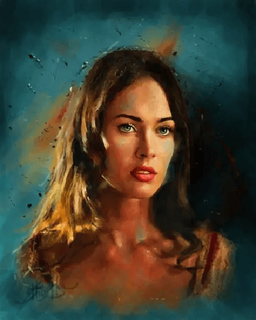 | 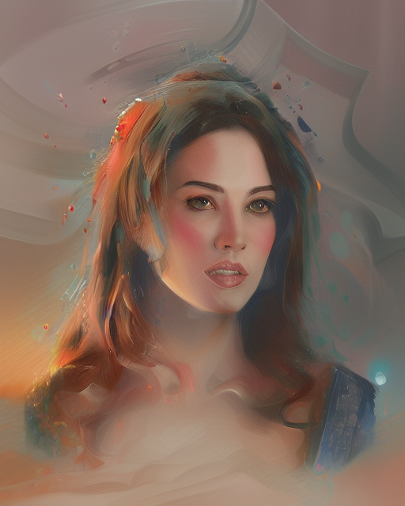 | 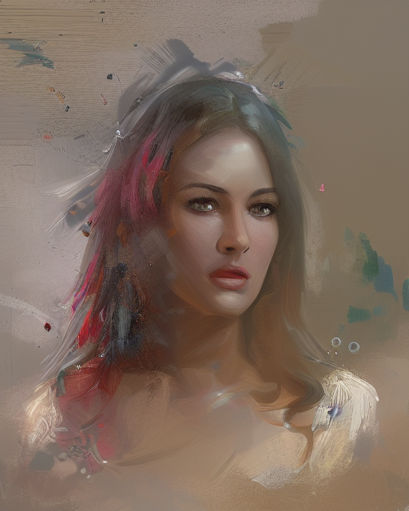 | 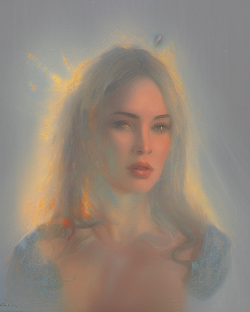 |


| 原图                                            | 生成图 1                                    | 生成图 2                                    | 生成图 3                                    |
| --------------------------------------------- | ---------------------------------------- | ---------------------------------------- | ---------------------------------------- |
| 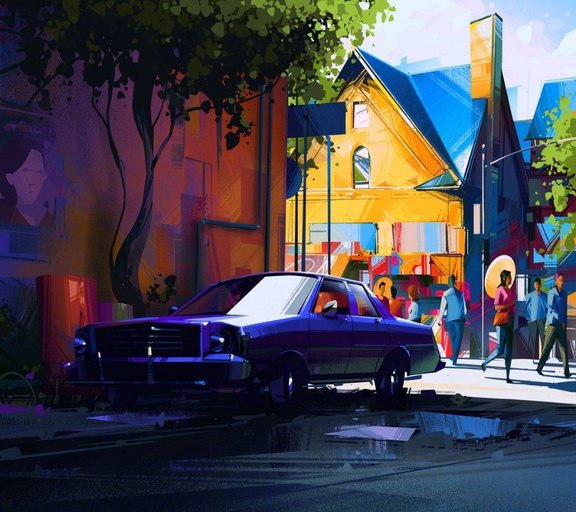 | 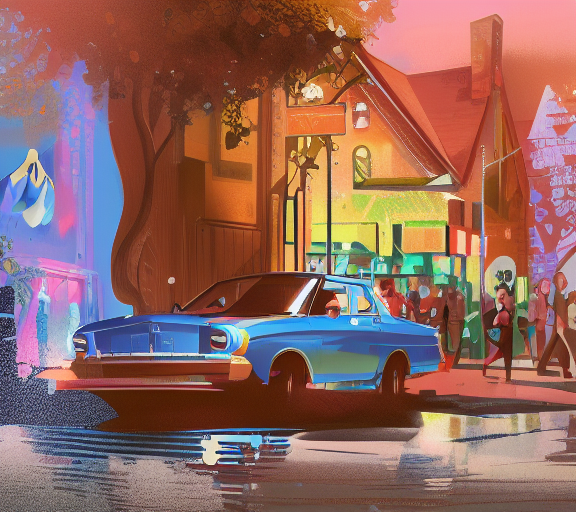 | 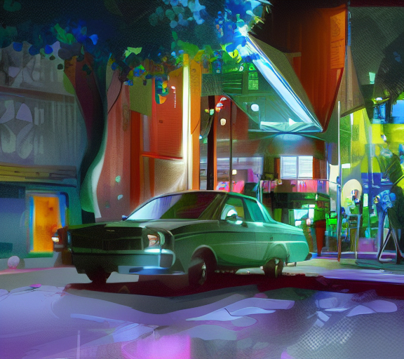 | 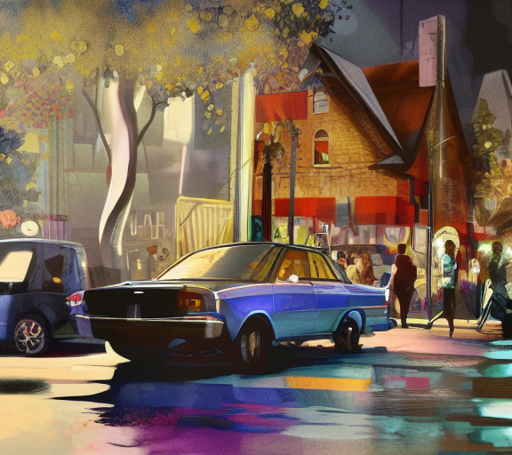 |


| 原图                                             | 生成图 1                                     | 生成图 2                                     | 生成图 3                                     |
| ---------------------------------------------- | ----------------------------------------- | ----------------------------------------- | ----------------------------------------- |
| 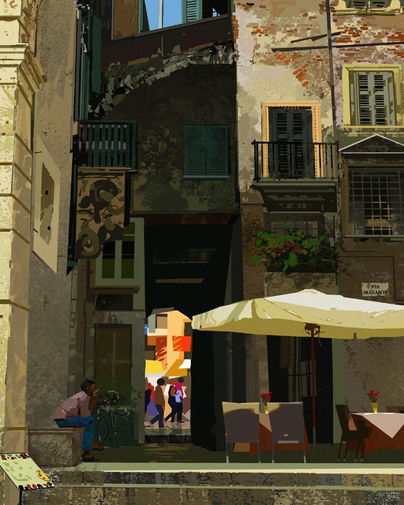 | 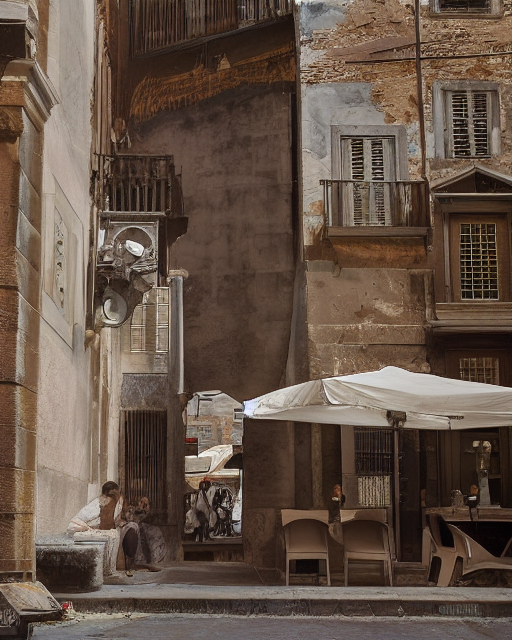 | 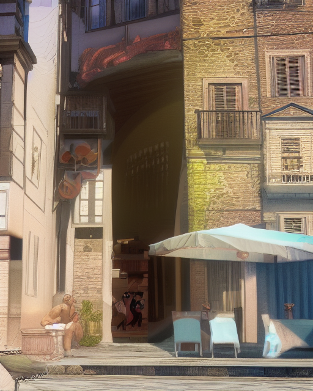 | 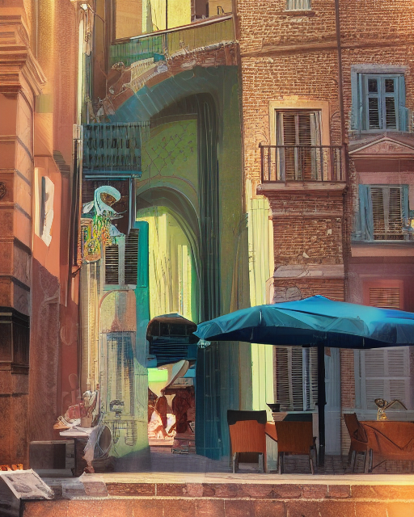 |


---


## 1. 环境准备

推荐使用 Miniconda（参考官方文档安装）。

创建环境：

```bash
conda env create -f environment.yaml
```

激活环境：

```bash
conda activate artistx
```

---


## 2. 目录说明

- `data/input_images`：用户上传或输入的原图
- `data/sketches`：ControlNet 线稿中间结果
- `data/generated_images`：最终生成图像
- `loras`：LoRA 权重文件（`.safetensors`）
- `webapp`：Web UI 前端与后端页面逻辑

---


## 3. 快速开始（推荐：Web UI）

启动 Web UI：

```bash
conda run -n artistx python run_web.py
```

浏览器打开：

```text
http://127.0.0.1:7860
```

在页面中可完成以下流程：

1. 上传原图（会保存到 `data/input_images`）
2. 选择 LoRA 风格（读取 `loras` 中权重）
3. 设置生成参数（`Num` 为循环生成次数）
4. 浏览生成结果并下载到本地（图片保存到 `data/generated_images`）

> Seed 逻辑：  
>
> - 留空：每轮随机新 seed（结果更有变化）  
> - 填写具体值：每轮固定同一 seed（结果可复现）

---


## 4. 脚本方式生成

你也可以直接修改 `generate_images.py` 中 `main()` 的参数后运行：

```bash
python generate_images.py
```

核心函数：`generate_images(...)`

---


## 5. 运行与性能说明

- 优先使用 GPU；若无 GPU 会自动回退到 CPU
- 速度参考：
  - GPU：约 4s/张（视显卡与参数而定）
  - CPU：约 7min/张
- 当前环境中 PyTorch 使用 CUDA 12.8；如与你机器驱动不匹配，可在 `environment.yaml` 中调整

---


## 6. LoRA 使用建议

以下为通用参数建议，可作为起点后按场景微调。

- 推荐参数：
  - `num_inference_steps=30`
  - `guidance_scale=3`
  - `negative_prompt="owres, bad anatomy, bad hands, extra fingers, deformed face, asymmetrical eyes, distorted, oversaturated, overexposed"`
  - `num_images_per_prompt=1`
  - `controlnet_conditioning_scale=0.8`
  - `guess_mode=False`
  - `lora_scale=0.8`
- 参数说明：
  - 上述组合可让 ControlNet 更稳定地遵循原始草稿结构，同时叠加你指定的 LoRA 风格进行生成。
  - `guess_mode=False` + 合理的 `controlnet_conditioning_scale` 有助于减少结构漂移与细节幻觉。
  - 对复杂度较高的场景，可将 `num_inference_steps` 提升至 `45` 或 `60` 以增强稳定性与细节还原。

---


## 7. LoRA 训练参考

- [kohya_ss](https://github.com/bmaltais/kohya_ss)
- [How to train Stable Diffusion LoRA models](https://techtactician.com/how-to-train-stable-diffusion-lora-models/)

